<div align="center">

# 🏗️ Archifast

**From a sentence to a buildable architectural package — in one skill.**

[](LICENSE)
[](https://github.com/verycoolapps/Archifast/releases)
[](#)
[](#)

*Dari satu kalimat menjadi denah yang siap dibangun.*

</div>

---

Archifast adalah **AI skill untuk arsitektur** yang menghasilkan denah lantai (*floor plans*),/site plan, *room schedule*, dan diagram zonasi — lewat alur kerja lengkap: **discovery → spatial programming → adjacency → 3 alternatif desain → denah berdimensi → responsif iklim tropis → aksesibilitas → paket dokumentasi penuh**.

Archifast is an **architectural AI skill** that produces floor plans, site plans, room schedules, and zoning diagrams — through a complete workflow: **discovery → spatial programming → adjacency → 3 design alternatives → dimensional plans → tropical climate response → accessibility → full documentation package**.

Bukan sekadar "gambar denah dari AI" — Archifast mengikuti proses perancangan yang sesungguhnya, sehingga hasilnya koheren, masuk akal secara spasial, dan bisa langsung dipakai untuk diskusi dengan klien atau pengembang.

Not just "AI drawing a floor plan" — Archifast follows a real design process, so the output is spatially coherent, buildable, and ready for client or contractor discussion.

---

## ✨ Features / Fitur

| | English | Bahasa Indonesia |
|---|---|---|
| 🧭 | **Structured design process** — discovery → programming → zoning → alternatives | **Proses desain terstruktur** — discovery → programming → zoning → alternatif |
| 📐 | **Dimensional plans** — walls, doors, windows, dimensions, area tags | **Denah berdimensi** — dinding, pintu, jendela, dimensi, label luas |
| 🌴 | **Tropical climate response** — shading, cross-ventilation, sun orientation | **Responsif iklim tropis** — shading, ventilasi silang, orientasi matahari |
| ♿ | **Accessibility-aware** — clearances, circulation, universal design checks | **Peduli aksesibilitas** — clearance, sirkulasi, cek universal design |
| 📋 | **Room schedules & area tables** — every room quantified | **Room schedule & tabel luas** — setiap ruang terhitung |
| 📦 | **Full documentation package** — plans, sections narrative, specs summary | **Paket dokumentasi lengkap** — denah, narasi, ringkasan spesifikasi |
| 🔁 | **3 alternatives by default** — real choices, not one take-it-or-leave-it | **3 alternatif bawaan** — pilihan nyata, bukan satu hasil jadi |

---

## 🗺️ Workflow / Alur kerja

```mermaid
flowchart LR
    A([💬 User brief<br/>site, budget,<br/>family, climate]) --> B[🔎 Discovery<br/>site analysis,<br/>constraints]
    B --> C[📊 Spatial programming<br/>room list,<br/>relationships]
    C --> D[🧩 Adjacency matrix<br/>what belongs<br/>next to what]
    D --> E[🎨 3 design alternatives<br/>concepts compared]
    E --> F[📐 Dimensional plans<br/>walls · doors ·<br/>windows · dims]
    F --> G[🌴 Tropical + ♿ accessible<br/>climate response,<br/>access checks]
    G --> H[📦 Documentation package<br/>plans · schedules ·<br/>specs summary]
    H --> I([📤 Export<br/>SVG · PDF-ready ·<br/>Markdown])

    style A fill:#fef3c7,color:#78350f
    style B fill:#dbeafe,color:#1e3a8a
    style C fill:#e0e7ff,color:#3730a3
    style D fill:#ede9fe,color:#5b21b6
    style E fill:#fce7f3,color:#9d174d
    style F fill:#dcfce7,color:#166534
    style G fill:#cffafe,color:#155e75
    style H fill:#fee2e2,color:#991b1b
    style I fill:#f3f4f6,color:#111827
```



---

## 🚀 Quick start / Mulai cepat

Cukup deskripsikan proyek dalam bahasa sehari-hari — Archifast yang mengurus sisanya.

Just describe the project in plain language — Archifast handles the rest.

```text
User:  desain rumah 2 lantai untuk keluarga 4 orang di lahan 10x15m,
       2 kamar tidur, carport, kebun kecil, iklim tropis Indonesia

Archifast output:
  ✅ Site analysis        — lahan 10×15m, orientasi, setback, area hijau
  ✅ Room program         — 8 ruang, total ±120 m², relasi antar-ruang
  ✅ Adjacency matrix     — dapur↔ruang tamu↔dining, privasi kamar
  ✅ 3 alternatif konsep  — A: courtyard, B: linear, C: split-level
  ✅ Denah berdimensi     — lantai 1 & 2, label dinding/pintu/jendela
  ✅ Iklim tropis         — shading facade barat, cross-ventilation
  ✅ Aksesibilitas        — lebar koridor ≥90cm, ramp carport
  ✅ Room schedule        — tabel luas per ruang per lantai
  ✅ Dokumentasi paket    — ringkasan spesifikasi & catatan desain
```

---

## 📁 Repository layout / Struktur repositori

```
Archifast/
├── README.md                  # This file / Berkas ini
├── LICENSE                    # MIT license / Lisensi MIT
└── Archifast/
    ├── SKILL.md               # Skill definition & workflow / Definisi skill & alur kerja
    └── references/            # Design references / Referensi desain
        ├── room-program.md   # Room area benchmarks (m²) / Benchmark luas ruangan
        ├── adjacency.md      # Adjacency matrix template / Template matriks adjacensi
        ├── evaluation.md     # Scoring rubric & QC checklist / Rubrik penilaian & checklist QC
        └── documentation.md  # 12-step doc package / Paket dokumentasi 12 langkah
```

---

## 🆚 Why Archifast? / Kenapa Archifast?

| Approach / Pendekatan | Pros / Kelebihan | Cons / Kekurangan |
|---|---|---|
| **Generic AI chat** | Fast, flexible | No design process; inconsistent dimensions; no standards |
| **Human architect** | Deep expertise, site visits | Expensive, slow, not instant iteration |
| **CAD software** | Precise, industry standard | Steep learning curve; blank-canvas problem |
| **🏗️ Archifast** | Real design workflow, dimensional output, tropical-aware, bilingual, instant | Concept-stage output — needs professional review for construction |

Archifast occupies the space between a napkin sketch and a hired architect: fast enough for iteration, structured enough to be credible.

Archifast mengisi ruang antara sketsa awal dan arsitek berlisensi: cukup cepat untuk iterasi, cukup terstruktur untuk dipercaya.

---

## ⚠️ Scope & disclaimer / Ruang lingkup & disclaimer

Archifast menghasilkan **konsep dan dokumentasi tahap awal**. Untuk bangunan nyata, selalu konsultasikan dengan arsitek/biro desain berlisensi dan patuhi peraturan setempat (PBG, IMB setempat, dsb).

Archifast produces **concept and pre-design documentation**. For real construction, always consult a licensed architect and comply with local regulations.

---

## 📜 License

MIT — bebas digunakan, dimodifikasi, dan didistribusikan dengan atribusi.

MIT — free to use, modify, and distribute with attribution.

---

<div align="center">

Made with 🏗️ by [VeryCoolApps](https://github.com/verycoolapps)

*"Denah yang baik dimulai dari memahami, bukan sekadar menggambar."*

</div>
